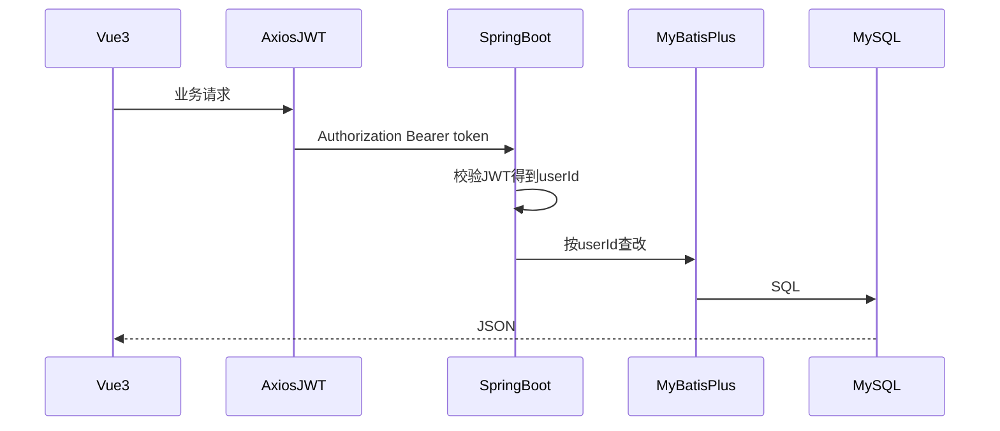

# 四年前端转全栈：10 天上手清单

面向：已经会 Vue 做页面、调接口的前端；从 2026-09-28 起全天学习，国庆假期结束（约 10-07）达到「简单上手」。

目标不是成为 Java 后端专家，而是能独立跑通这一条链：

**Vue3 页面 → JWT 调接口 → Spring Boot → MyBatis-Plus → MySQL → Docker Compose 部署**

若你要学的是「用 AI 加快写代码」，读 `cursor/用AI加快写代码.md`。若要搞清 Agent 名词，读 `cursor/前端转Agent学习清单.md`。本文只覆盖全栈最小闭环。

你已有的能力可以直接用上：组件边界 ≈ Controller 边界，TypeScript interface ≈ Java DTO/record，axios 拦截器 ≈ JWT 过滤器，`package.json` ≈ `pom.xml`。

---

## 0. 目标与原则

假期结束验收（五条都要过）：

1. 能注册、登录，刷新页面登录态还在。
2. 笔记/待办 CRUD 正常，且只能看到自己的数据。
3. 没 Token 不能访问业务接口。
4. 公网或局域网能打开部署后的页面。
5. 能讲清：请求怎么走、Token 存在哪、两张表怎么设计。

学习原则：

- **60% 写项目，30% 查文档，10% 看概念。** 卡住 20 分钟就查，查完立刻写回项目。
- 语言版本锁定 **Java 21**，框架锁定 **Spring Boot 3**。不要从 Java 8 / XML 配置考古。
- 每天必须有「能跑的产出」，不是看完课。
- 一次只学当天要用的。Redis、微服务、JVM 调优全部延后。

全天节奏：

- 上午 3–4 小时：跟文档写代码
- 下午 3–4 小时：自己改、踩坑、补缺口
- 晚上 1 小时：写 10 行笔记 + 明日清单
- 单段视频不要超过 1 小时不暂停敲代码

---

## 1. 学习目录总览

按顺序学，不要跳着攒知识。

| 顺序 | 模块 | 学到什么算过 | 大约天数 |
| --- | --- | --- | --- |
| 1 | Java 够用基础 | class / record / List / Map / 异常 / Maven 打 jar | Day 1 |
| 2 | Spring Boot Web | 统一返回体、CRUD、全局异常 | Day 2 |
| 3 | MySQL + MyBatis-Plus | 建表、CRUD 落库、重启数据还在 | Day 3 |
| 4 | 注册登录 JWT | BCrypt、签发 Token、拦截、按用户隔离 | Day 4 |
| 5 | Vue3 联调 | axios 带 Token、登录页、列表增删改 | Day 5 |
| 6 | 打磨 | 校验、空状态、错误提示、README | Day 6 |
| 7 | Docker Compose 部署 | mysql + api + 前端静态，能访问 | Day 7–8 |
| 8 | 加一个小功能 | 搜索 / 置顶 / 回收站 三选一前后端都改完 | Day 9 |
| 9 | 验收 | 五条清单过、能口述请求链路 | Day 10 |

请求链路：



---

## 2. 技术栈（锁定，假期里不要换）

| 层 | 用这个 | 不要碰 |
| --- | --- | --- |
| 语言 | Java 21 | Java 8 教程当主线 |
| 后端 | Spring Boot 3 | 微服务、Dubbo、XML Servlet |
| 持久化 | MyBatis-Plus | 同时学 JPA |
| 数据库 | MySQL 8 | 分库分表 |
| 鉴权 | JWT + BCrypt + 过滤器 | 一上来深挖 Spring Security 全家桶 |
| 前端 | Vue 3 + Vite + Vue Router + Pinia + axios | 为转全栈再换 React |
| 部署 | Docker Compose + Nginx 反代 `/api` | K8s |

前端 TypeScript 不是门槛：你本来用 JS 就先 JS，别为了 TS 卡住 Day 5。

工具：JDK 21、IntelliJ IDEA、Node、MySQL 8、Postman（或 Apifox）、Git、Docker Desktop。

---

## 3. 每个模块在哪里学最好

原则：**官方文档当主教材，中文教程只用来查语法和抄最小示例。不要同时开 3 套视频课。**

### 3.1 Java 基础

主教材（查语法、对照前端概念）：

- [廖雪峰 Java 教程](https://www.liaoxuefeng.com/wiki/1252599548343744) — 只看：面向对象、集合、异常、Maven。跳过网络、反射、注解处理器。
- 需要纸书时挑读《Java 核心技术 卷 I》的 class / 接口 / 泛型 / 集合章节，不要通读。

官方对照（遇到版本差异时）：

- [Oracle Java Tutorials（精简篇）](https://docs.oracle.com/javase/tutorial/) — 只查当前卡住的那一节。
- 语言级别按 **21**：本地变量类型推断、record、text block 可以直接用。

前端对照：`interface` ≈ TypeScript interface；`record` ≈ 不可变 DTO；`List`/`Map` ≈ 数组/对象字典；Maven ≈ npm。

### 3.2 Spring Boot

主教材（跟做，不要只看）：

- [Spring Boot 官方 Getting Started](https://spring.io/quickstart)
- [Building a RESTful Web Service](https://spring.io/guides/gs/rest-service/)
- [Building REST services with Spring](https://spring.io/guides/tutorials/rest/) — 看到能写 Controller 即可，HATEOAS 可跳过。

中文查漏：

- [Spring Boot 3 官方参考文档](https://docs.spring.io/spring-boot/reference/index.html) — 只查 `application.yml`、starter 依赖。
- 百度/掘金搜「Spring Boot 3 统一返回体 全局异常」看一篇结构清楚的即可，不要连看五篇风格不同的。

项目入口用 [Spring Initializr](https://start.spring.io/)：依赖勾 `Spring Web`，Day 3 再加 `MySQL Driver`、`MyBatis-Plus`（或先加 MyBatis，再按 MP 文档换）。Packaging 选 Jar，Java 选 21。

### 3.3 MySQL

主教材：

- [MySQL 8 官方入门：Tutorial](https://dev.mysql.com/doc/refman/8.0/en/tutorial.html) — 建库、建表、INSERT/SELECT/UPDATE/DELETE。
- 索引只需要知道：主键、唯一索引、给 `user_id` 加普通索引。不要学执行计划优化。

中文查漏：

- 菜鸟教程 MySQL 篇只当速查（CREATE TABLE 语法）。
- 建表约定：`id` 主键自增、`created_at` / `updated_at`、业务表必有 `user_id`。

### 3.4 MyBatis-Plus

只认官方，避免新旧 API 混用：

- [MyBatis-Plus 快速开始](https://baomidou.com/getting-started/)
- [CRUD 接口](https://baomidou.com/guides/wrapper/) — `lambdaQuery` 会用 eq/like/orderBy 即可。

Entity 对应一张表，Mapper 继承 `BaseMapper<T>`，Service 里不要写 SQL 字符串（假期项目用不到 XML）。

### 3.5 JWT 与密码

假期路线：**自己写 Filter 校验 JWT，不要把 Spring Security 配成主战场。**

必读：

- 密码：Spring 的 `BCryptPasswordEncoder`（官方 Security 文档里 Password Encoder 一节即可）。
- JWT：选一个仍在维护的库（如 `jjwt`），跟其 README 做签发与解析。只实现：登录发 Token、请求头 `Authorization: Bearer <token>`、Filter 里解析出 `userId` 放入请求上下文。

中文跟做选 **一篇** 2024–2026 年的「Spring Boot 3 JWT 过滤器」文章，对照官方 Filter 注册方式（`OncePerRequestFilter` + `FilterRegistrationBean` 或 Security filter chain）。若文章还在教 `WebSecurityConfigurerAdapter`，直接换一篇。

先不学：OAuth2、SSO、Refresh Token 轮转、复杂 RBAC。

### 3.6 Vue3 联调

前端你已经会。本仓库对照：

- [web/vue/vue3快速上手.md](../web/vue/vue3快速上手.md)

官方只补联调缺口：

- [Vue Router](https://router.vuejs.org/zh/) — 路由守卫：没 Token 跳登录。
- [Pinia](https://pinia.vuejs.org/zh/) — 存用户信息和 Token。
- [axios](https://axios-http.com/zh/) — 请求拦截器带 Token；响应 401 清 Token 并跳登录。

Vite 开发时用 `server.proxy` 把 `/api` 转到 `http://localhost:8080`，避免跨域浪费一下午。

### 3.7 部署

主教材：

- [Docker Get Started](https://docs.docker.com/get-started/) — 会写 Dockerfile 和 Compose 即可。
- Nginx 只需要一篇「反向代理 `/api` 到后端、`/` 托管前端 dist」。官方 [ngx_http_proxy_module](https://nginx.org/en/docs/http/ngx_http_proxy_module.html) 当查 `proxy_pass`。

Compose 三服务：`mysql`、`api`（Spring Boot jar）、`web`（Nginx + 前端静态文件）。密钥和数据库密码走环境变量，不要写进镜像。

---

## 4. 10 天日程（2026-09-28 至 10-07）

每天结束前用「产出」自检，没产出就算当天没完成。

### Day 1（09-28）环境 + Java 最小集

- 装 JDK 21、IDEA、Node、MySQL 8、Postman、Git、Docker Desktop。
- 用 Maven 建一个非 Web 的小项目：`List`/`Map`、一个 `record`、读入再打印。
- 会 `mvn -q package` 打出 jar。

产出：本地跑通一段 Java main，能向别人讲清 class 和 record 的差别。

### Day 2（09-29）Spring Boot 第一天

- Initializr 建 `note-api`（Spring Web）。
- `GET /api/health` 返回 ok。
- 内存版笔记 CRUD：`GET/POST/PUT/DELETE /api/notes`。
- 统一返回 `{ code, message, data }`，全局异常处理。

产出：Postman 调通 health + 四个笔记接口。

### Day 3（09-30）MySQL 接入

- 建库 `note_app`，建表 `user`、`note`（结构见第 5 节）。
- 接入 MyBatis-Plus，把内存 CRUD 改成查库。
- `application.yml` 里写数据源（本地密码不要提交到 Git）。

产出：重启后端，昨天插入的笔记还在。

### Day 4（10-01）登录鉴权

- `POST /api/auth/register`、`POST /api/auth/login`。
- 密码 BCrypt 存储；登录返回 JWT。
- Filter：除 `/api/auth/**`、`/api/health` 外都要 Token。
- 笔记接口全部带 `user_id` 条件，禁止改别人的行。

产出：没 Token 访问 `/api/notes` 得到 401；两个账号数据互不可见。

### Day 5（10-02）Vue 联调

- Vite + Vue3：登录页、笔记列表、新增/编辑。
- axios 封装：BaseURL `/api`，自动带 Token，401 跳登录。
- 路由守卫。

产出：浏览器走通注册 → 登录 → CRUD，不靠 Postman。

### Day 6（10-03）打磨成能给别人用

- 表单校验、空列表提示、接口错误展示。
- 删除二次确认。分页可选，有就加分。
- 根目录 README：如何起 MySQL、后端、前端。

产出：按 README 从零启动成功。

### Day 7（10-04）Docker Compose

- 后端 Dockerfile（多阶段：build + 运行 jre）。
- 前端 build 后用 Nginx 镜像托管。
- `docker-compose.yml` 起 mysql + api + web。

产出：`docker compose up -d` 后浏览器能打开页面。

### Day 8（10-05）配置分离与反代

- `DB_URL`、`JWT_SECRET`、数据库密码走环境变量。
- Nginx：`/` 静态，`/api` 反代到 api 容器。
- 看日志、进程挂了能重启。

产出：换一台机器按文档也能拉起。

### Day 9（10-06）只加一个小功能

三选一，前后端都改完：笔记搜索、置顶、回收站。不要三个都做。

产出：新功能有接口、有页面、有表字段或查询条件。

### Day 10（10-07）验收与复盘

过第 0 节五条清单。写一页「这 10 天学会了什么」（请求链路、两张表、Token 存在哪）。假期后要补的东西只记在第 7 节，当天不要开新坑。

---

## 5. 练习项目规格（笔记 / 待办）

项目名建议：`note-app`。前后端分两个目录，不要塞进本仓库的个人站 `apps/web`（个人站是 Cloudflare Pages 多入口，和这次练习无关）。

### 5.1 推荐目录

```
note-app/
  api/                 # Spring Boot
    src/main/java/.../common/      # 统一返回、异常
    src/main/java/.../auth/        # 注册登录、JWT、Filter
    src/main/java/.../note/        # Entity / Mapper / Service / Controller
    src/main/resources/application.yml
    Dockerfile
  web/                 # Vue3 + Vite
    src/api/
    src/views/LoginView.vue
    src/views/NoteListView.vue
    src/router/
    src/stores/
    Dockerfile
  docker-compose.yml
  README.md
```

### 5.2 表结构

```sql
CREATE TABLE user (
  id            BIGINT PRIMARY KEY AUTO_INCREMENT,
  username      VARCHAR(32)  NOT NULL UNIQUE,
  password_hash VARCHAR(100) NOT NULL,
  created_at    DATETIME     NOT NULL DEFAULT CURRENT_TIMESTAMP
);

CREATE TABLE note (
  id          BIGINT PRIMARY KEY AUTO_INCREMENT,
  user_id     BIGINT       NOT NULL,
  title       VARCHAR(80)  NOT NULL,
  content     TEXT         NOT NULL,
  created_at  DATETIME     NOT NULL DEFAULT CURRENT_TIMESTAMP,
  updated_at  DATETIME     NOT NULL DEFAULT CURRENT_TIMESTAMP ON UPDATE CURRENT_TIMESTAMP,
  INDEX idx_note_user_id (user_id)
);
```

Day 9 若做置顶，给 `note` 加 `pinned TINYINT NOT NULL DEFAULT 0`；若做回收站，加 `deleted_at DATETIME NULL`。

### 5.3 接口清单

统一响应：

```json
{ "code": 0, "message": "ok", "data": {} }
```

业务失败用非 0 的 `code`；未登录 HTTP 401。

| 方法 | 路径 | 说明 | 鉴权 |
| --- | --- | --- | --- |
| GET | `/api/health` | `{ "status": "ok" }` | 否 |
| POST | `/api/auth/register` | body: `{ username, password }` | 否 |
| POST | `/api/auth/login` | body 同上；data 含 `token` | 否 |
| GET | `/api/notes` | 当前用户笔记列表 | 是 |
| POST | `/api/notes` | body: `{ title, content }` | 是 |
| PUT | `/api/notes/{id}` | body: `{ title, content }` | 是 |
| DELETE | `/api/notes/{id}` | 只删自己的 | 是 |

登录响应示例：`{ "code": 0, "message": "ok", "data": { "token": "...", "username": "hao" } }`。

Vue 把 Token 放 `localStorage`（键名自定，如 `note.token`），axios 拦截器读取。这和本站 `hao.<id>.v1` 约定无关，练习项目可独立命名。

### 5.4 本地启动顺序（未容器化时）

1. 启动 MySQL，执行建表 SQL。
2. 后端 `8080`，`application.yml` 指向本地库。
3. 前端 Vite `5173`，proxy `/api` → `8080`。

---

## 6. 验收清单（Day 10 打印勾选）

- [ ] JDK 21 + Maven 能打包 api
- [ ] `GET /api/health` 返回 ok
- [ ] 注册后数据库 `user.password_hash` 不是明文
- [ ] 登录拿到 JWT，后续请求 Header 带 Bearer
- [ ] 无 Token 访问 `/api/notes` 为 401
- [ ] 用户 A 看不到、改不了用户 B 的笔记
- [ ] 浏览器完成注册、登录、增删改、刷新仍登录
- [ ] README 能让另一人从零启动
- [ ] Docker Compose（或等价部署）浏览器能打开
- [ ] 能口述 mermaid 那条链路

---

## 7. 假期后再学（现在学只会分心）

- Redis 缓存、Session 与 JWT 对比
- 事务隔离级别、慢 SQL、索引深入
- Spring Security 完整配置、Refresh Token
- 文件上传 OSS、定时任务
- JVM / GC / 并发包
- 微服务、消息队列、K8s

第 11 天起若继续全栈：把笔记做成「可分享只读链接」，或按本站红线做留言（Turnstile + 先审后发）——那已经超出本清单，需要后端真正存一份别人可见的数据。

---

## 8. 今晚立刻做的 3 步

1. 装好 JDK 21、IDEA、MySQL。
2. Initializr 建项目，跑通 `GET /api/health`。
3. 新建 Vue 项目，页面请求 health，页面上显示 `ok`。

前后端第一次握手成功，后面 9 天会顺很多。
