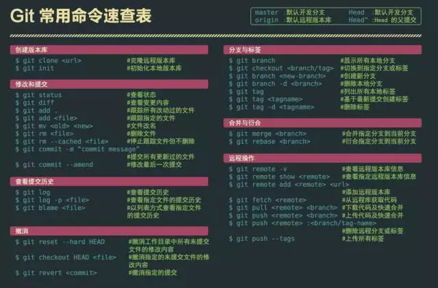

# 04 · 表格、代码、引用、任务与图片

## 目录

- [表格](#表格)
- [代码块](#代码块)
- [引用](#引用)
- [任务列表](#任务列表)
- [图片](#图片)
- [转义字符](#转义字符)

---

## 表格

```markdown
| 项目 | 状态 | 备注 |
|------|------|------|
| 联调 | 已完成 | PC |
| 自测 | 进行中 | APP |
| 提测 | 待开始 | — |
```

| 项目 | 状态 | 备注 |
|------|------|------|
| 联调 | 已完成 | PC |
| 自测 | 进行中 | APP |
| 提测 | 待开始 | — |

对齐：

```markdown
| 左对齐 | 居中 | 右对齐 |
|:-------|:----:|-------:|
| a | b | c |
```

| 左对齐 | 居中 | 右对齐 |
|:-------|:----:|-------:|
| a | b | c |

---

## 代码块

行内：`` `const a = 1` `` → `const a = 1`

围栏代码块（可标语言高亮）：

````markdown
```js
function hello(name) {
  return `hi, ${name}`
}
```
````

```js
function hello(name) {
  return `hi, ${name}`
}
```

```bash
git pull origin main
git status
```

```vue
<template>
  <button @click="onSubmit">提交</button>
</template>
```

---

## 引用

```markdown
> 这是引用
>
> 第二段引用
>
> > 嵌套引用
```

> 这是引用
>
> 第二段引用
>
> > 嵌套引用

日报重点常用：

```markdown
> **本日重点：** 一句话总结今天最重要的产出
```

> **本日重点：** 一句话总结今天最重要的产出

---

## 任务列表

（GitHub / 多数预览器支持）

```markdown
- [x] 接口联调
- [x] 自测
- [ ] 冒烟
- [ ] 提测
```

- [x] 接口联调
- [x] 自测
- [ ] 冒烟
- [ ] 提测

---

## 图片

```markdown


```

仓库内相对路径示例：

```markdown

```

也可控制 HTML 宽度（部分环境）：

```html

```

---

## 转义字符

想显示字面量 `*`、`#`、`[` 等，前面加 `\`：

```markdown
\*不是斜体\*
\# 不是标题
```

\*不是斜体\*

\# 不是标题
