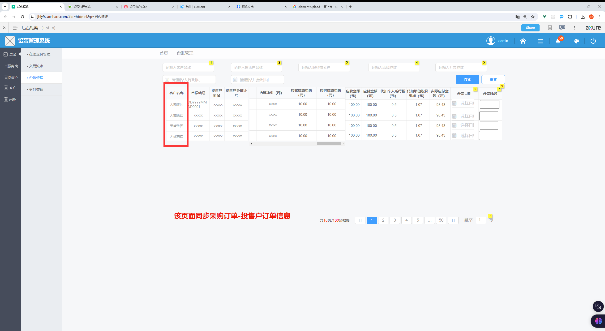

- 台账好像缺个字段
  

- steel/orderDetailList
  {    "msg": "【628580】系统异常，请稍后再试",    "code": 500,    "message": "【628580】系统异常，请稍后再试"}
  这个列表搜索有点问题
- 台账跳转后保存开票吨数、开票日期可能会请求数据量过大

- 交易流水没有导出回执单接口
- 支付管理支付时发送字段有疑问
- 投售户账单列表缺少余额字段
- 投售户账单详情 业务类型没有标注
- 采购列表附件字段
- 支付管理导入模版服务商模版没有

