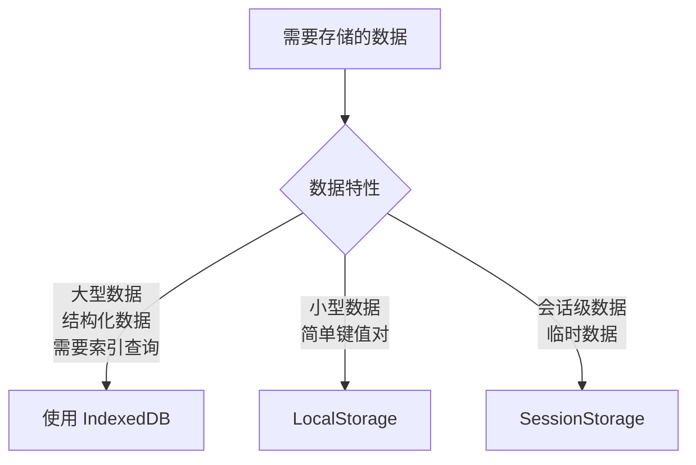
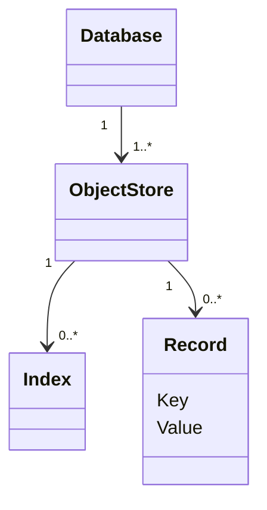

## 🗄️ 浏览器 IndexedDB 从零详解

### 一、什么是 IndexedDB？

IndexedDB（索引数据库）是浏览器内置的：

- 事务型NoSQL数据库
- 支持异步操作（不阻塞主线程）
- 基于键值对存储（key-value）
- 支持索引查询（类似SQL的索引）
- 可存储结构化数据（不限字符串）

### 二、核心应用场景



### 三、核心概念架构

#### 1. 层级结构



#### 2. 关键组件详解

| 组件                       | 说明         | 类比SQL概念 |
| -------------------------- | ------------ | ----------- |
| **数据库(Database)**       | 顶级容器     | 数据库      |
| **对象存储(Object Store)** | 表结构       | 数据表      |
| **索引(Index)**            | 特殊查询字段 | 索引字段    |
| **事务(Transaction)**      | 原子操作单元 | 事务        |
| **游标(Cursor)**           | 遍历机制     | SELECT遍历  |

### 四、核心操作全流程

```javascript
// 1. 打开/创建数据库
const request = indexedDB.open('myDatabase', 1);

// 2. 处理数据库升级（创建对象存储和索引）
request.onupgradeneeded = (event) => {
  const db = event.target.result;
  
  // 创建用户对象存储（设置主键为自增ID）
  const usersStore = db.createObjectStore('users', {
    keyPath: 'id',
    autoIncrement: true
  });
  
  // 在email字段上创建唯一索引
  usersStore.createIndex('email_idx', 'email', { unique: true });
};

// 3. 数据库打开成功后进行操作
request.onsuccess = (event) => {
  const db = event.target.result;
  
  // 4. 启动事务（读写操作）
  const transaction = db.transaction('users', 'readwrite');
  const store = transaction.objectStore('users');
  
  // 5. 添加用户数据
  const addUser = store.add({
    name: '张三',
    email: 'zhangsan@example.com',
    age: 28 
  });
  
  // 6. 按索引查询（通过email）
  const getRequest = store.index('email_idx')
    .get('zhangsan@example.com');
  
  getRequest.onsuccess = () => {
    console.log('查询结果:', getRequest.result);
  };
  
  // 7. 关闭数据库（通常不需要显式关闭）
  // db.close(); 
};

// 错误处理
request.onerror = (event) => {
  console.error('数据库错误:', event.target.error);
};
```

### 五、完整操作API速查

| 方法                              | 作用          | 示例                                        |
| --------------------------------- | ------------- | ------------------------------------------- |
| `IDBFactory.open()`               | 打开数据库    | `indexedDB.open(name, version)`             |
| `IDBDatabase.createObjectStore()` | 创建存储对象  | `db.createObjectStore(name, options)`       |
| `IDBObjectStore.add()`            | 添加数据      | `store.add(value)`                          |
| `IDBObjectStore.put()`            | 更新/替换数据 | `store.put(value, key)`                     |
| `IDBObjectStore.get()`            | 获取单条数据  | `store.get(key)`                            |
| `IDBObjectStore.delete()`         | 删除数据      | `store.delete(key)`                         |
| `IDBObjectStore.clear()`          | 清空存储      | `store.clear()`                             |
| `IDBObjectStore.createIndex()`    | 创建索引      | `store.createIndex(name, keyPath, options)` |
| `IDBObjectStore.index()`          | 获取索引      | `store.index(name)`                         |
| `IDBCursor`                       | 数据遍历      | `store.openCursor()`                        |

### 六、实际应用建议

#### ✅ 最佳实践

1. **使用Promise封装API**

```javascript
function openDB(name, version, upgradeCallback) {
  return new Promise((resolve, reject) => {
    const request = indexedDB.open(name, version);
    request.onupgradeneeded = upgradeCallback;
    request.onsuccess = () => resolve(request.result);
    request.onerror = reject;
  });
}
```

1. **批量写入优化**

- 使用单事务处理多个操作
- 避免在循环中启动多个事务

1. **版本升级策略**

- 使用`db.version`检测是否需要迁移
- 提供数据迁移脚本

#### ⚠️ 限制注意事项

| 限制项       | 详细说明                                                 |
| ------------ | -------------------------------------------------------- |
| **存储空间** | Chrome最大可用80%硬盘空间 Firefox/Safari限制在1-10GB     |
| **事务超时** | 默认60秒无活动自动回滚                                   |
| **数据类型** | 支持：ArrayBuffer, Array, Map, Set 不支持：函数, DOM元素 |
| **同源策略** | 不同来源网站无法访问彼此数据库                           |

### 七、应用场景推荐

1. 离线应用数据持久化（PWA应用）
2. 缓存大型API响应数据
3. 富媒体文件（音视频缩略图）
4. 编辑器草稿自动保存
5. 复杂表单历史版本

#### 性能对比

```mermaid
%%[mermaid]
barChart
    title 存储方案性能比较
    x-axis 操作类型
    y-axis 时间(ms) 0 100
    series 小型数据
        localStorage: 0.1
        IndexedDB: 2
        SQLite: 15
    series 10000条数据
        localStorage: 1200
        IndexedDB: 150
        SQLite: 60
%%[/mermaid]
```

### 八、学习资源

1. [MDN IndexedDB文档](https://developer.mozilla.org/zh-CN/docs/Web/API/IndexedDB_API)
2. [IndexedDB Promised 封装库](https://github.com/jakearchibald/idb)
3. [浏览器存储配额管理API](https://developer.mozilla.org/en-US/docs/Web/API/StorageManager)