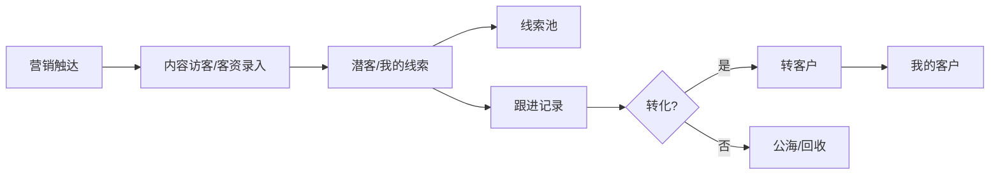
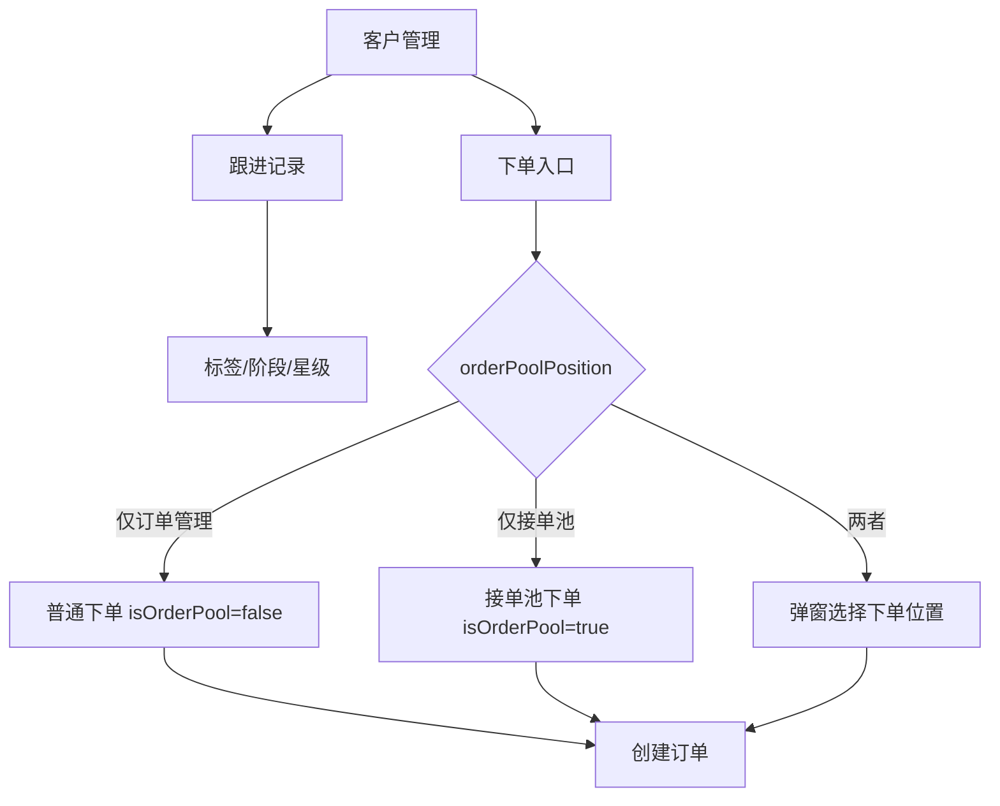
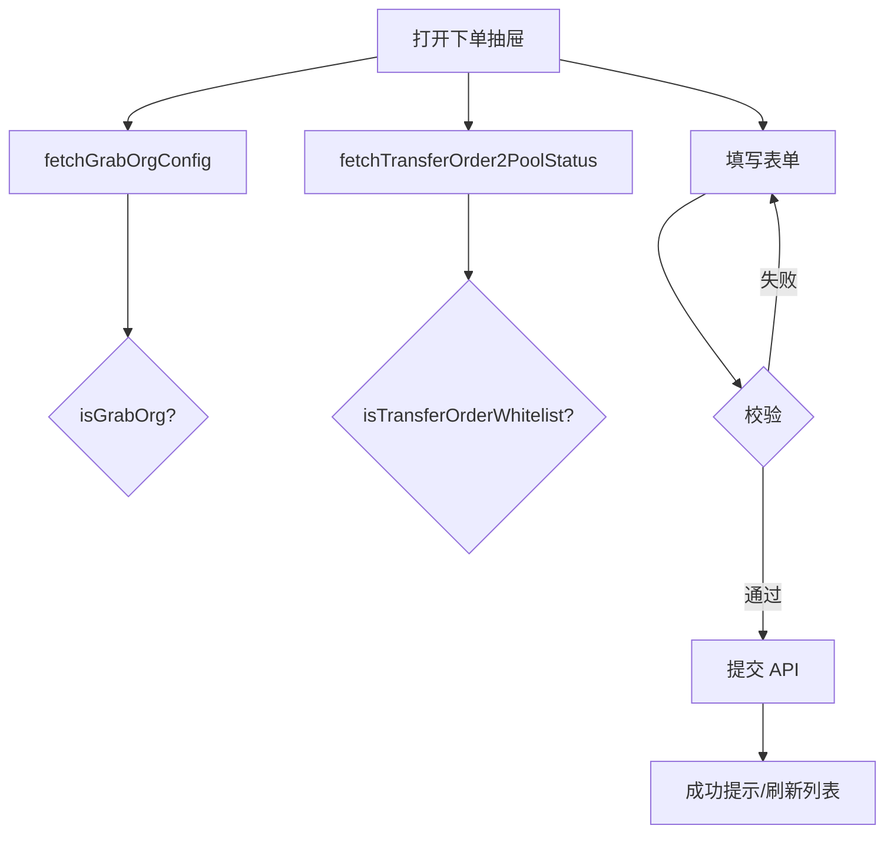
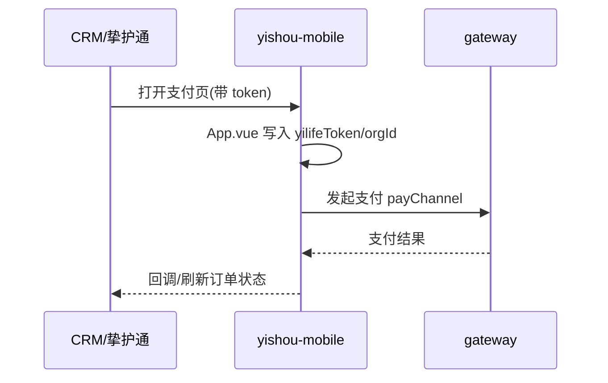
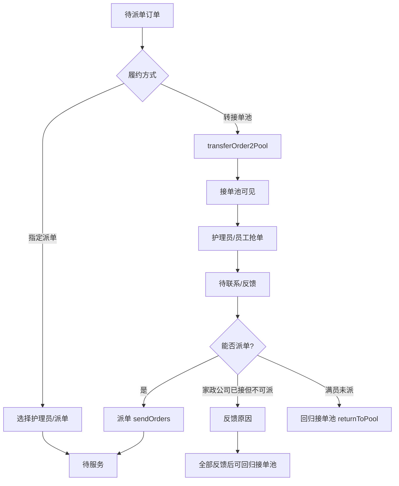
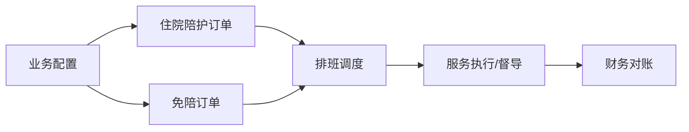
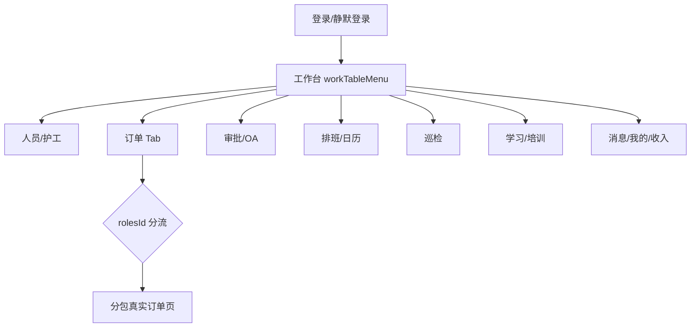
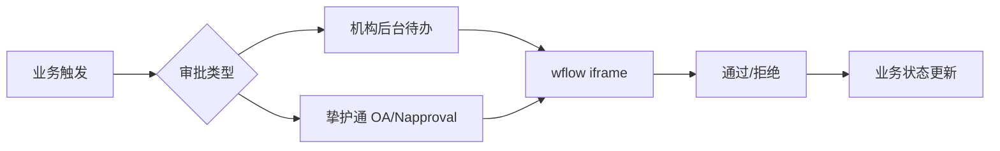
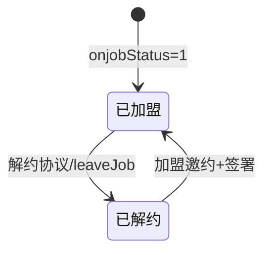
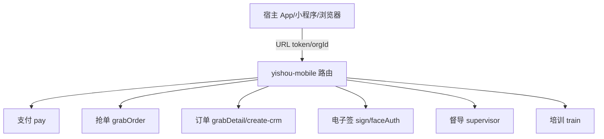

# 颐挚业务 · 公司业务与流程详解

> **性质：** 基于四前端仓库（`yishou-mobile` / `workcrm-web` / `organization-background` / `nurse-mini`）代码、项目认识答案及项目问题备忘交叉还原；**非官方 SOP**。不确定处标「未从代码确认」。  
> **系列入口：** [项目认识 · 索引](./项目认识%20·%20索引.md) · 简版全景见 [公司业务流程](./公司业务流程.md)  
> **更新说明：** 在简版基础上补充白名单/租户、前置后置、跨系统衔接与关键路径。

---

## 目录

1. [公司业务总览](#一公司业务总览)
2. [线索获客](#二线索获客)
3. [客户转化与跟进](#三客户转化与跟进)
4. [CRM 下单](#四crm-下单)
5. [支付](#五支付)
6. [派单与接单池](#六派单与接单池)
7. [机构履约（住院/免陪）](#七机构履约住院免陪)
8. [排班与一线作业](#八排班与一线作业)
9. [财务结算与开票](#九财务结算与开票)
10. [审批](#十审批)
11. [人员管理（照护师/护工）](#十一人员管理照护师护工)
12. [培训与质控](#十二培训与质控)
13. [H5 嵌入场景](#十三h5-嵌入场景)
14. [附录](#附录)

---

## 一、公司业务总览

### 1.1 公司在做什么

颐挚（品牌「颐挚科技」，协议主体线索含「上海颐寿健康科技有限公司」）面向 **家政 / 院内护工 / 居家护工 / 居家月嫂 / 陪诊 / 钟点工 / 居间单** 等照护服务，把：

| 价值链环节 | 核心动作 |
|------------|----------|
| 获客与销售 | 营销触达 → 线索/潜客 → 跟进 → 客户 → 下单 |
| 收款 | H5/APP 支付、现金/公对公/团购券等多渠道 |
| 履约调度 | 指定派单、接单池抢单、跨租户协同 |
| 机构运营 | 照护师档案、住院/免陪订单、排班、财务、审批 |
| 一线移动作业 | 挚护通工作台、订单、开票结算、巡检、学习 |
| 合规签约 | 加盟/解约协议、电子签、证书管理 |

串成 `*.yza.cn` 网关体系下的多端产品矩阵。

**一句话：** CRM 卖单、机构后台管人管钱、挚护通干活、H5 容器承接支付/抢单/签约等嵌入场景。

### 1.2 角色 × 系统矩阵

| 角色 | 主要系统 | 典型职责 |
|------|----------|----------|
| 内部销售 / 管理 | `workcrm-web`（CRM） | 线索、客户、跟进、下单、派单、接单池、营销、工作手机风控 |
| 机构 / 医院用户 | CRM（部分）+ `organization-background` | 机构侧协同；照护师、住院/免陪、排班、财务、审批 |
| 管家 / 门店运营 | `nurse-mini`（挚护通） | 工作台：人员、订单、审批、开票结算、排班、巡检、学习 |
| 护理员 / 护工 / 接单方 | 挚护通 + `yishou-mobile` 抢单 H5 | 看单、接单、派单反馈、服务执行 |
| C 端客户 / 家属 | 其它 C 端 + `yishou-mobile` | 支付、签约、守护设备等 |
| 督导 / 培训 | 机构 AI 督导 + H5 督导/培训 | 质控、日志、考试 |

### 1.3 产品矩阵与职责边界

```text
                         ┌─────────────────────┐
                         │ login / gateway     │
                         │ yapi / 各后端服务   │
                         └──────────┬──────────┘
            ┌───────────────────────┼───────────────────────┐
            │                       │                       │
   ┌────────▼────────┐   ┌─────────▼─────────┐   ┌─────────▼─────────┐
   │  workcrm-web    │   │ organization-     │   │  yishou-mobile    │
   │  内部 CRM 后台  │   │ background        │   │  业务 H5 容器     │
   │  线索→单→派单   │   │ 机构运营后台      │   │  支付/抢单/签约…  │
   └────────┬────────┘   │ 人·单·班·钱·审    │   └─────────┬─────────┘
            │            └─────────┬─────────┘             │
            └──────────┬───────────┘                       │
                       │                                   │
              ┌────────▼────────┐                          │
              │   nurse-mini    │◄── fe-static / WebView ─┘
              │   挚护通移动端  │
              └─────────────────┘
```

| 仓库 | 产品称呼 | 端 | 业务重心 |
|------|----------|----|----------|
| `workcrm-web` | 颐挚科技 CRM | PC Web | 销售漏斗、订单、接单池、营销、工作手机 |
| `organization-background` | 机构/陪护后台 | PC Web | 照护师、住院/免陪、排班、财务、审批 |
| `nurse-mini` | 挚护通 | 微信小程序 + H5 | 一线日常运营与履约协同 |
| `yishou-mobile` | （聚合 H5） | WebView / 微信 H5 | 支付、抢单、订单详情、电子签、督导培训等 |

**相关但不在四仓内：** `work-phone`（工作手机）、`wflow-web`（审批流）、`survey-form`（表单）、挚护到家 `home-service`、登录中心。

### 1.4 统一身份与租户

| 项 | 约定（四前端共性） |
|----|-------------------|
| 登录中心 | `login-*.yza.cn` |
| Token Cookie | `yilifeToken`（URL 可带 `_token` / `token` 写入） |
| 机构/租户 | `orgId`；请求头常同时带 `tenantId`（= orgId） |
| 用户 | `userId` / `X-AUTH-UID` |
| 系统标识 | `systemCode`（CRM 常见 `100020`/`touch`；机构后台默认 `100002`；挚护通联调常见 `100035`） |
| 菜单数据权限 | 请求头 `resourceId`（当前菜单资源 id） |
| 网关 | `gateway-*.yza.cn`，本地 dev 改各仓 `env.ts` 的 `devEnv` |

**跨系统打开 H5/小程序时：** 宿主必须带齐 `_token`、`_orgId`、`_userId`、`_systemCode`（或等价 query），否则 401 或数据权限错误。

---

## 二、线索获客

### 2.1 业务说明

销售漏斗最上游：通过营销物料、外呼、表单、内容访客、抖音/美团等渠道沉淀 **潜客/线索**，进入「我的线索」或「线索池」，供销售跟进与转化。

### 2.2 参与角色与系统

| 角色 | 系统 | 模块 |
|------|------|------|
| 销售 / 运营 | CRM | `marketing-center`、`customer-manage` |
| 风控 | CRM | `device-manage`、`record-manage`（工作手机） |

### 2.3 详细流程



**典型 CRM 路径：**

1. 登录 → `api16003` 用户 + `api14371` 租户 + `api14379` 菜单
2. 营销中心创建/投放：落地页、文章、音视频、短信、智能外呼、微表单、个人名片、短链等
3. 客资进入「我的线索」(`/aicrm/my-customer-lead`) 或「线索池」(`/aicrm/my-customer-lead-pool`)
4. 跟进：标签、阶段、星级（CRM 设置）；可关联工作手机通话/微信记录
5. 转化：线索转客户；未转化可进公海再被捞取

### 2.4 注意事项

| 类别 | 要点 |
|------|------|
| **权限/租户** | 菜单由 `api14379` 按 `orgId` + `systemCode` 返回；切换租户用 Header「切换机构」 |
| **前置条件** | 有效登录 Token；线索需归属当前销售或符合公海/池规则（后端） |
| **后置操作** | 转客户后可从客户页/线索详情 **下单**（见第四节）；线索详情可打开客资跟进抽屉 |
| **白名单** | 路由白名单（401/404/iframe 等）在 `filterRouter.ts`，与业务「进池白名单」不同 |
| **常见坑** | CRM 路由守卫多处 `next()` 直接放行，菜单权限偏弱；iframe 嵌入模式用 `hideHeader`/`bypassAuth` 等 query |
| **跨系统** | 线索详情下单抽屉与挚护通/接单池联动（`poolOrderStatus`、`clueId` 传参） |

**关键页面（CRM）：**

- 我的线索：`/aicrm/my-customer-lead`
- 线索池：`/aicrm/my-customer-lead-pool`
- 客资跟进抽屉：`views/system-manage/customer-follow/`

---

## 三、客户转化与跟进

### 3.1 业务说明

已转化客户进入「我的客户 / 客户公海」，持续跟进、画像、群组运营，并作为 **下单入口** 的主数据（联系人、被照护人、地址等预填）。

### 3.2 参与角色与系统

| 角色 | 系统 |
|------|------|
| 销售 | CRM `customer-manage` |
| 销售管理 | CRM `sales-manage`（跟进记录、目标、汇报） |

### 3.3 详细流程



**下单位置解析（CRM）：** `resolveOrderPoolPosition(customerId)` 调 `organization-admin/poolOrder/orderPoolPosition`：

- `type=1` → 订单管理（普通单）
- `type=2` → 接单池
- 返回多个选项时弹出「下单位置」对话框

### 3.4 注意事项

| 类别 | 要点 |
|------|------|
| **前置条件** | 客户 `customerId`；部分入口带 `customIntentionId`（意向） |
| **后置操作** | 下单成功触发 `ORDER_CREATED` 刷新列表；可「查看订单」跳详情 |
| **接单池下单** | payload 带 `isOrderPool: true`（测试用例 CO-063） |
| **居间单与阿姨** | 抢单订单（`isOrderPool`）居间单 **不展示** 选择阿姨；非抢单租户 + **进池白名单用户** + 普通单才展示（见 4.4） |
| **常见坑** | 关闭下单抽屉再次打开应清空表单（CO-002）；脱敏手机号提交时用 `defaultPhone` 替换（CO-062） |
| **跨系统** | 客资跟进「订单情况」Tab 可打开挚护通订单详情 H5，URL 带 `poolOrderStatus`、`clueId` |

---

## 四、CRM 下单

### 4.1 业务说明

CRM 侧创建服务订单，支持多种 **operation** 类型，对应不同接口与表单字段。

### 4.2 订单类型（CRM 枚举）

| orderType | 名称 |
|-----------|------|
| 1 | 院内护工 |
| 2 | 居家月嫂 |
| 3 | 居家护工 |
| 4 | 陪诊 |

**下单抽屉 operation（客资跟进 create-order）：**

| operation | 场景 | 提交接口（代码可见） |
|-----------|------|---------------------|
| `HOSPITAL_ORDER` | 自营医院单 | `multiHospitalCreateOrder` |
| `NON_SELF_HOSPITAL_ORDER` | 非自营医院单（无病区） | `multiThirdPartyCreateOrder` |
| `HOME_ORDER` | 居家（短期/长期/陪诊/钟点工/居间单） | `multiHomeCreateOrder` / 居间单 `createBrokerOrder` |

### 4.3 订单状态主线

```text
待支付(1) → 待派单(2) → 待服务(3) → 服务中(4) → 已完成(8) / 已取消(9)
```

### 4.4 详细流程（下单抽屉）



### 4.5 注意事项

| 类别 | 要点 |
|------|------|
| **白名单 · 进池** | `GET organization-admin/admin/transferOrder2PoolStatus` → 当前用户是否 **可选普通/接单池** 下单（`isTransferOrderWhitelist`） |
| **白名单 · 抢单机构** | `api72392` 返回 `grabOrgIds`，当前 `orgId` 在内则为 **抢单租户**（`isGrabOrg`） |
| **居间单选阿姨** | `showNurseCarerSelect = !isGrabOrg && isTransferOrderWhitelist && !isOrderPool` |
| **前置条件** | 医院单：院点 → 病区 → 套餐级联；居家单：地图选点 + 详细地址（非居间）；居间单：合同模板/纸质 PDF、居间服务费 |
| **后置操作** | 待支付 → 引导支付（H5）；待派单 → 派单或转接单池 |
| **续约** | 传 `orderId` 打开抽屉，表单 disabled，提交 `updateRenewalOrderPackageV2` |
| **常见坑** | 切换订单类型（短期↔长期↔居间）需清空关联字段；结束时间必须晚于开始时间；纸质合同最多 8 个文件 |
| **跨系统** | 挚护通 `createMultiOrder?from=grabOrder` 新增单自动提示「将发布在接单池内」 |

**关键代码：**

- CRM 下单抽屉：`workcrm-web/.../create-order/index.vue`
- 下单位置：`workcrm-web/src/utils/orderPoolPosition.ts`
- 订单枚举：`workcrm-web/src/views/order/detail/enum/index.js`

---

## 五、支付

### 5.1 业务说明

订单创建后进入待支付，收款多在 **yishou-mobile H5** 完成（微信/支付宝/APP 内支付等），CRM/挚护通展示支付状态。

### 5.2 参与角色与系统

| 角色 | 系统 |
|------|------|
| 客户 / 销售代付 | `yishou-mobile` `views/pay/*` |
| 状态展示 | CRM 订单详情、挚护通订单 |

### 5.3 详细流程



### 5.4 支付渠道（CRM 枚举摘录）

| payChannel | 说明 |
|------------|------|
| 1 | 客户微信自行支付 |
| 2 | 主管微信代支付 |
| 3 | 客户二维码支付 |
| 4 | 客户短信 H5 支付 |
| 6 | 现金支付 |
| 7 | 公对公打款 |
| 13 | 团购券支付 |
| … | 另有 APP 微信/支付宝/云闪付、零元、补录等 |

### 5.5 注意事项

| 类别 | 要点 |
|------|------|
| **前置条件** | H5 必须带 Token；`http.ts` 对 body/params 做 MD5 签名 |
| **后置操作** | 支付成功 → 订单进 **待派单**（以后端状态机为准） |
| **特殊支付** | 加盟费/保证金：`payment-pcn.vue`、`payment-pcn-guarantee.vue` |
| **常见坑** | 401 在 App 内走 `JSBridge.toLogin()`；浏览器侧未必统一跳登录页 |
| **危险区** | 改 `SECRET_KEY`/签名逻辑影响全站请求；支付页有真假支付分支注释 |

**关键路径：**

- H5 支付：`yishou-mobile/src/views/pay/`
- 路由：`yishou-mobile/src/router/modules/pay.js`

---

## 六、派单与接单池

### 6.1 业务说明

履约调度两条主路径：

1. **指定派单：** 销售/管家在订单详情或列表选定护理员（`api11199` 多套餐派单等）
2. **接单池（抢单）：** 订单进入池内，多租户/多护理员抢单、联系、反馈、派单

订单可在「固定归属」与「池内抢单」之间流转：**转接单池**、**回归接单池**。

### 6.2 参与角色与系统

| 动作 | CRM | 挚护通 | yishou-mobile H5 |
|------|-----|--------|------------------|
| 接单池列表（销售侧） | `/crm/grabOrder/sales` | — | — |
| 抢单（护理员/员工） | — | 部分能力 | `/grabOrder/nurse/order`、`/grabOrder/staff/order` |
| 转接单池 | 订单列表/详情 | 订单列表/详情 | — |
| 回归接单池 | 接单池/订单详情 | 订单详情 | grabDetail/sales、staff 待联系 |
| 派单给抢单人 | — | sendOrders | `/grabOrder/staff/sendOrders` |
| 不可派单反馈 | — | feedback | `/grabOrder/staff/feedback` |

### 6.3 接单池核心概念

| 字段/配置 | 含义 |
|-----------|------|
| `poolOrderStatus` | `0` 非抢单；非 0 为抢单/池内单 |
| `isOrderPool` | 下单时标记进入接单池 |
| `grabOrderOrgIds` | 机构白名单：在此列表内 **始终显示** 客资池订单操作栏 |
| `grabOrderPoolExpireSeconds` | 池内订单过期时间（默认约 3 天，后端配置） |
| `maxGrabCount` | 最大抢单人数；满员且待派单时可「回归接单池」 |
| 抢单记录状态 | 0 待抢单 1 待联系 2 已派单 3 护工拒绝 4 未派中 5 销售反馈取消 |

### 6.4 详细流程



### 6.5 注意事项（重点）

| 类别 | 要点 |
|------|------|
| **白名单 · 进池权限** | `transferOrder2PoolStatus`：机构/用户是否允许 **转单进池** 及下单时选池 |
| **白名单 · 操作栏** | `grabOrderOrgIds`（接口 `carer-platform/poolOrder/...`）：客资单已入池时，**非白名单机构隐藏** 底部操作栏（`isClueGrabPoolOrder`） |
| **转接单池** | 接口 `POST organization-admin/admin/transferOrder2Pool`；文案：**一旦转入无法撤销** |
| **转接单池显示** | `orderStatus === 2`（待派单）或后端 `showTransferGrabPool` |
| **回归接单池前置** | 若已有家政公司接单，须对 **全部** 不可派单原因反馈后，才可手动回归 |
| **回归接单池条件（CRM）** | `orderStatus === 2` 且 `grabbers.length === maxGrabCount` |
| **后置操作** | 转池后 `poolOrderStatus != 0`；详情接口切换为抢单详情 `api71408` |
| **租户** | 「销售租户」与「接单租户」行为不同：接单租户挚护通订单详情有「回归/转接单池」 |
| **常见坑** | 客资跟进打开挚护通详情需拼 `poolOrderStatus`；抢单 H5 与小程序 redirect 逻辑较脆 |
| **跨系统** | CRM iframe/链接打开 `mobile-*.yza.cn` 或本地 H5 `#/subPackagesOrder/...` |

**关键接口：**

| 接口 | 说明 |
|------|------|
| `organization-admin/admin/transferOrder2PoolStatus` | 进池白名单查询 |
| `organization-admin/admin/transferOrder2Pool` | 订单转进池 |
| `organization-admin/poolOrder/orderPoolPosition` | 下单位置配置 |
| `carer-platform/poolOrder/transferOrder2Pool` | 挚护通转接单池 |
| `carer-platform/poolOrder/grabOrder` | 抢单 |
| `carer-platform/poolOrderCarer/orderPoolSearchCarer` | 池内搜护理员 |

**关键页面路径：**

| 系统 | 路径 |
|------|------|
| CRM 接单池 | `/crm/grabOrder/sales` |
| CRM 订单 | `/crm/order` |
| H5 护士抢单 | `/grabOrder/nurse/order` |
| H5 员工抢单 | `/grabOrder/staff/order` |
| H5 派单 | `/grabOrder/staff/sendOrders` |
| H5 反馈 | `/grabOrder/staff/feedback` |
| 挚护通订单 | `subPackagesOrder/pages/order/index/index` |
| 挚护通详情 | `subPackagesOrder/pages/order/orderDetail/orderDetail` |

---

## 七、机构履约（住院/免陪）

### 7.1 业务说明

机构后台管理 **院内履约** 侧订单与配置，与 CRM 销售单形成「销售侧 / 机构运营侧」双轨（是否同一订单域：**未从代码完全确认**）。

### 7.2 参与角色与系统

| 角色 | 系统 | 模块 |
|------|------|------|
| 机构运营 | organization-background | `inpatientCare`、`noEscortCare` |
| 配置 | 同上 | `businessManagement`（套餐/站点/医院项目） |

### 7.3 详细流程



### 7.4 注意事项

| 类别 | 要点 |
|------|------|
| **与 CRM 关系** | CRM 偏卖与派；机构后台偏院内履约；对账详情可跳 **住院订单详情** |
| **前置条件** | 照护师档案、医院/站点配置就绪 |
| **后置操作** | 排班 → 服务 → 薪资/对账/开票 |
| **权限** | 生产环境路由按二级 path 校验菜单；**开发环境 `isDev` 绕过** |
| **常见坑** | `http.ts` 注释「大坑」：`orgId` 注入顺序影响 params |
| **跨系统** | 域名配置可互跳 CRM、挚护通 H5、`wflow-web` |

**关键路径：**

- 住院订单：`organization-background/src/views/inpatientCare/`
- 免陪：`noEscortCare/`、`noEscortCareCompare/`
- 业务配置：`businessManagement/`

---

## 八、排班与一线作业

### 8.1 业务说明

排班、日历、工作日志、服务巡检、订单处理等 **一线日作业**，主入口为挚护通；机构后台有排班管理模块。

### 8.2 参与角色与系统

| 角色 | 系统 |
|------|------|
| 管家 / 护理员 | nurse-mini |
| 排班管理 | organization-background `workforceManage`/`scheduling` |

### 8.3 挚护通一日闭环



### 8.4 注意事项

| 类别 | 要点 |
|------|------|
| **权限** | 菜单 `getUserResourceOfMini`；按钮 `hasPermission` / `$hasPermission` |
| **前置条件** | 微信侧 `silentLogin`；H5 侧 JSBridge 登录 |
| **订单 Tab** | `pages/order/index` 为壳，按 `rolesId` `reLaunch` 到不同分包订单页 |
| **401** | 微信 silentLogin 失败 → 授权页；H5 → `jsBridge.toLogin` |
| **status=4** | 部分无权限跳录入/报名页 |
| **常见坑** | 双 custom-tabbar；改订单入口易踩角色分支 |

---

## 九、财务结算与开票

### 9.1 业务说明

订单完成后进入 **开票、结算、薪资对账、收入** 等财务闭环，分散在机构后台与挚护通。

### 9.2 参与角色与系统

| 能力 | 主系统 |
|------|--------|
| 薪资、对账、开票 | organization-background `financialManagement` |
| 财务统计（新） | `financesManageNew` |
| 一线开票/结算/收入 | nurse-mini `subPackagesOrder`（IssueInvoice）、`subPackagesMy` |
| 云账户 | nurse-mini `apis/yunzhanghu.js` |

### 9.3 注意事项

| 类别 | 要点 |
|------|------|
| **危险区** | 改价、退款、开票、对账、税金模块 |
| **双轨目录** | `financialManagement` 与 `financesManageNew` 并存 |
| **后置操作** | 开票/结算常走 **审批**（退款、结算方式变更） |
| **跨系统** | 对账跳住院订单详情；机构后台 ↔ wflow 发票袋 |

---

## 十、审批

### 10.1 业务说明

机构侧审批、待办、发票袋、印章等；流程引擎多嵌 **wflow-web**；挚护通有 OA 分包。

### 10.2 参与角色与系统

| 系统 | 方式 |
|------|------|
| organization-background | iframe 嵌 `wflow-web-*.yza.cn` |
| nurse-mini | `subPackagesOA`、`subPackagesIndex/.../Napproval` |
| CRM | 部分销售审批路由 **已注释** |

### 10.3 详细流程



### 10.4 注意事项

| 类别 | 要点 |
|------|------|
| **前置条件** | wflow iframe 带 `orgId`/实例参数 |
| **待办角标** | 机构后台 `wflowWflowFlowDataTodosGetAll` 拉取 |
| **挚护通** | 退款审批 `refund`、结算方式 `settlementMethod` |
| **常见坑** | CRM `approval` 等菜单注释但目录仍在 |

---

## 十一、人员管理（照护师/护工）

### 11.1 业务说明

照护师/护工从 **招聘面试 → 档案证书 → 加盟签约 → 能力/小组 → 可派单** 的全生命周期。

### 11.2 参与角色与系统

| 环节 | 系统 |
|------|------|
| 档案/证书/能力 | organization-background `nurseManage` |
| 面试/体检/考核 | `interview`、`physicalExamination`、`examinationManage` |
| 一线人员管理 | nurse-mini `nursingWorker`、`manage` |
| 协议配置 | organization-background `preference`（加盟/解约协议） |
| 合同签署 | nurse-mini `subPackagesIndex/pages/contract` |

### 11.3 加盟/解约流程（代码可见）



### 11.4 注意事项

| 类别 | 要点 |
|------|------|
| **协议类型** | preference：`加盟协议(JM)`、`解约协议(JCJM)` |
| **解约接口** | 原版：`organization-admin/orgAdmin/carerinfo/updateOnJobStaus`（备忘中有 dev 示例） |
| **证书** | 机构后台 `nurseManage/edit-home`；详情页 `nurseCreditQuery=1` |
| **白名单（派单优先）** | 挚护通阿姨详情可「加入/移出白名单」（优先派单、溢价、免押金等） |
| **抢单机构** | 机构后台照护师页 `grabOrderOrdId`：仅抢单机构展示特定能力 |
| **前置条件** | 解约需原因类型 `leaveJobReasonType`/`leaveJobReason` |
| **后置操作** | 解约后 `onjobStatus=0`，影响派单/抢单可选列表 |
| **跨系统** | PC 护理人员页 ↔ 小程序 hospital/manage/nursingWorker/contract |

**备忘链接：** [26.7.16-合同、证书、加盟协议、解约协议](../项目问题/26.7.16-合同、证书、加盟协议、解约协议.md)

---

## 十二、培训与质控

### 12.1 业务说明

服务中 **巡检、评价、督导日志、AI 小结**；能力提升通过 **培训/考试**（挚护通学习 Tab + H5 train/learning + 机构 aiSupervisor）。

### 12.2 参与角色与系统

| 能力 | 系统 |
|------|------|
| 巡检 | nurse-mini `subPackagesService` |
| 督导/反馈 | yishou-mobile `supervisor`、机构 `aiSupervisor` |
| 培训考试 | nurse-mini `subPackagesTraining`、H5 `train`/`learning` |

### 12.3 注意事项

| 类别 | 要点 |
|------|------|
| **跨系统** | 培训订单可跳 `home-service*.yza.cn` |
| **数据权限** | 机构 `role-manage/data` 配置 AI 督导查看范围 |

---

## 十三、H5 嵌入场景

### 13.1 业务说明

`yishou-mobile` **不是独立主站**，而是被 App/小程序/浏览器打开的 **业务页聚合仓**。

### 13.2 典型嵌入链路



### 13.3 注意事项

| 类别 | 要点 |
|------|------|
| **Token** | `App.vue` 从 query 写 Cookie；多种 param 名兼容 |
| **默认路由** | `/` → `/visitorWifi`（非业务首页） |
| **小程序 redirect** | 抢单详情在满足条件时 redirect 到小程序分包 |
| **双轨** | 多套 request 封装、Vant+Antd 并存 |
| **常见坑** | 改鉴权需确认走 `http.ts` 还是旧 `request.js` |

---

## 附录

### A. 环境与域名

| 用途 | 域名模式 |
|------|----------|
| API 网关 | `gateway-*.yza.cn` |
| 登录 | `login-*.yza.cn` |
| CRM | `work-crm-*.yza.cn` |
| 移动/H5 | `mobile-*.yza.cn` |
| 挚护通静态 | `fe-static.yza.cn/{env}/nurse-mini/web/` |
| 审批 | `wflow-web-*.yza.cn` |
| 工作手机 | `work-phone-*.yza.cn` |
| 接口文档 | `yapi.yza.cn` |
| 本地 | `local.yza.cn` + 各仓 dev 端口 |

### B. 关键接口速查

| 业务 | 方法 | 路径 |
|------|------|------|
| 进池白名单 | GET | `/organization-admin/admin/transferOrder2PoolStatus` |
| 转单进池 | POST | `/organization-admin/admin/transferOrder2Pool` |
| 下单位置 | GET/POST | `/organization-admin/poolOrder/orderPoolPosition` |
| 挚护通转池 | POST | `carer-platform/poolOrder/transferOrder2Pool` |
| 抢单 | POST | `carer-platform/poolOrder/grabOrder` |
| 用户权限 | — | `user-web-2`（api16003/14371/14379） |
| 多套餐派单 | POST | CRM `api11199` |
| 抢单详情 | — | CRM `api71408` |

### C. 关键页面路径速查

| 业务 | 系统 | 路径 |
|------|------|------|
| 我的线索 | CRM | `/aicrm/my-customer-lead` |
| 线索池 | CRM | `/aicrm/my-customer-lead-pool` |
| 订单管理 | CRM | `/crm/order` |
| 接单池 | CRM | `/crm/grabOrder/sales` |
| 照护师 | 机构 | `/nurseManage/index` |
| 协议配置 | 机构 | `/preference/index` |
| 工作台 | 挚护通 | `pages/index/index` |
| 护士抢单 H5 | yishou-mobile | `/grabOrder/nurse/order` |
| 员工抢单 H5 | yishou-mobile | `/grabOrder/staff/order` |
| CRM 下单 H5 | yishou-mobile | `/order/create-crm` |
| 支付 H5 | yishou-mobile | `/pay/*` |

### D. 相关文档

| 文档 | 说明 |
|------|------|
| [项目认识 · 索引](./项目认识%20·%20索引.md) | 四仓答案入口 |
| [公司业务流程](./公司业务流程.md) | 简版端到端全景 |
| [项目认识 · 答案（crm）](./项目认识%20·%20答案（crm）.md) | CRM 详解 |
| [项目认识 · 答案（organization-background）](./项目认识%20·%20答案（organization-background）.md) | 机构后台详解 |
| [新项目认识 · 答案（nurse-mini）](./新项目认识%20·%20答案（nurse-mini）.md) | 挚护通详解 |
| [项目认识 · 答案（yishou-mobile）](./项目认识%20·%20答案（yishou-mobile）.md) | H5 容器详解 |
| [26.6.23-接单池3.0](../项目问题/26.6.23-接单池3.0.md) | 接单池联调入口 |
| [26.6.30-接单池测试用例](../项目问题/26.6.30-接单池测试用例.md) | 下单/池用例 |
| [26.7.16-合同证书协议](../项目问题/26.7.16-合同、证书、加盟协议、解约协议.md) | 人员合规备忘 |

### E. 文档边界与待确认

1. 后端状态机、租户（接单租户 vs 销售租户）完整规则以服务端为准。  
2. CRM 销售单与机构「住院/免陪」单的主键映射：**未从代码完全确认**。  
3. C 端主站（挚护到家等）不在四仓内。  
4. `yapi` vs `ytt` 在机构后台的团队默认约定：**未从代码确认**。

---

*本文档由四前端代码静态分析生成，未运行服务、未调用线上接口。*
