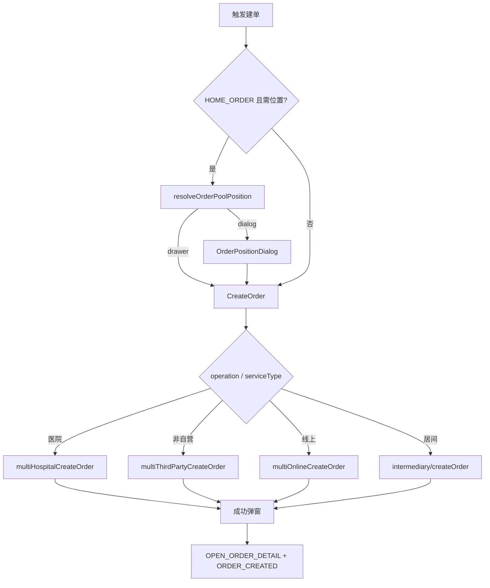

# 02 · 建单全流程

源码：[`create-order/index.vue`](../../src/views/system-manage/customer-follow/components/modal/drawer/create-order/index.vue)、[`orderPoolPosition.ts`](../../src/utils/orderPoolPosition.ts)、[`order-position-dialog`](../../src/views/customer-manage/component/order-position-dialog/index.vue)

返回：[总目录](./README.md)

---

## 1. 核心组件关系

```text
入口页面
  →（可选）resolveOrderPoolPosition / OrderPositionDialog
  → CustomerFollowDrawer（抽屉壳，确认调 submitForm）
      → CreateOrder（表单 + 提交）
```

---

## 2. 全部建单入口

| 入口 | 触发 | operation | 下单位置 |
|------|------|------------|----------|
| 我的线索 `my-clue/index.vue` | 行更多「新增订单」→ `handleClickCareteOrder` | `HOME_ORDER` | ✅ |
| 我的线索简版 | 同类 | `HOME_ORDER` | ❌ |
| 订单管理 `order/index.vue` | 顶部「新增订单」 | `HOME_ORDER` | ❌ 普通 |
| 接单池 `grabOrder/table.vue` | 顶部「新增订单」 | `HOME_ORDER` | ❌ 强制 `isOrderPool:true` |
| 客户跟进快捷菜单 | 医院单 / 新增订单 / 非自营 | 三种 | 仅 HOME 走位置 |
| 阿姨简历 `aunts-list` | 「下单」或下拉 | 三种 | 开关开启时走位置 |
| 阿姨档期/详情/位置 | 下单气泡 | 三种 | 经 `SEND_MESSAGE` 进跟进，HOME 仍走位置 |

---

## 3. 下单位置决策

### API

`GET /organization-admin/poolOrder/orderPoolPosition?customerId=`

返回 `{ name, type }[]`：

- `type=1` 订单管理 → `isOrderPool=false`
- `type=2` 接单池 → `isOrderPool=true`

### `resolveOrderPoolPosition(customerId)`

```text
API 结果
├─ 失败 / 空数组 → { action:"drawer", isOrderPool:false }
├─ 仅 1 条       → { action:"drawer", isOrderPool: type===2 }
└─ ≥ 2 条        → { action:"dialog", options, defaultValue:首条.type }
                     → 用户确认 → isOrderPoolByPositionType(selected)
```

弹窗组件：`OrderPositionDialog`（props：`dialogVisible` / `options` / `defaultValue`）。

**仅 `HOME_ORDER` 走位置选择**；医院单、非自营医院单一般不走。

### 对建单的影响

| 点 | 行为 |
|----|------|
| 提交 | body 追加 `isOrderPool: true` |
| 居间选阿姨 | 接单池强制隐藏（`showNurseCarerSelect=false`） |
| 成功看详情 | 事件带 `isOrderPool`，详情按池态打开 |

`showNurseCarerSelect`：接单池 → false；非抢单租户 + 白名单（`api69164`）+ 普通订单 → 居间可展示选阿姨。

---

## 4. operation / serviceType 与提交 API

### 4.1 `HOSPITAL_ORDER` 医院单（自营院内）

- 表单：院点 → 病区 → 套餐；床位/楼层/住院号；无居家地址；结束时间可编
- 套餐：院内套餐接口族（如 `getInComboPlatformInfo`）
- API：`multiHospitalCreateOrder`  
  `POST /organization-admin/org/onlineChannel/online/multiHospitalCreateOrder`

### 4.2 `HOME_ORDER` 线上单

- 内部 `getOnlineHospitalId` 绑定线上院点
- **serviceType**：1 短期 / 2 长期 / 3 陪诊 / 4 钟点工 / **5 居间**
- 非居间：套餐、feeMode 天数或小时、服务地址、被照护人；结束时间由开始+时长推算（禁用手改）
- API：`multiHomeCreateOrder`  
  `POST /organization-admin/org/onlineChannel/online/multiOnlineCreateOrder`

### 4.3 `NON_SELF_HOSPITAL_ORDER` 非自营医院单

- 有院点；无强制病区；有套餐与服务地址；无床位等
- API：`multiThirdPartyCreateOrder`  
  `POST /organization-admin/org/onlineChannel/online/multiThirdPartyCreateOrder`

### 4.4 居间单（`HOME_ORDER` + `serviceType=5`）

- 无套餐；服务类型标签、合同（电子/纸质）、合同总金额、居间服务费
- 无被照护人区块；客户来源、销售归属、休假/住家/学历/年龄等要求
- API：`createBrokerOrder`（`buildBrokerOrderPayload`）  
  `POST /organization-admin/intermediary/createOrder`
- 居间费计算：`calculateIntermediaryFee` → `/organization-admin/intermediary/calculateIntermediaryFee`

### 4.5 续约（有 `props.orderId`）

- 表单部分禁用；提交 `updateRenewalOrderPackageV2`  
  `POST /organization-admin/org/admin/updateRenewalOrderPackageV2`
- 列表侧续约按钮走的是独立组件 `renewal.vue`（见 [08](./08-支付合同审批续约.md)）

`submitForm` 内 `requestMap` + 居间覆盖；手机号若脱敏则回填 `defaultPhone` / `rawContact`。

---

## 5. 套餐、估价、模板

| 函数 | 作用 |
|------|------|
| `handleServiceTypeChange` | 切换订单类型，拉套餐平台信息 |
| `handleComboTypeChange` / `handlePackageChange` | 选套餐，刷新 `comboFeeVOList` |
| `canRequestFeeEstimate` | 居间/缺时间/无套餐/无医院 → 不估 |
| `getAmountParams` / `getAmountInfo` | `multiFeeEstimate` → `/organization-admin/orderFee/multiFeeEstimate` |
| `triggerHomeOrderFeeEstimate` | HOME 非居间触发估价 |
| `calculateEndTime` 等 | 服务时间与天数/小时联动 |
| `getTemplateFields` | 模板字段映射 `getTemplateFieldsWithMapping` |

金额展示：`amountInfo.vue`（商品合计 / 节假日加收 / 套餐明细等；居间走合同金额逻辑）。

---

## 6. 关键入参（CreateOrder）

| 名称 | 作用 |
|------|------|
| `operation` | 医院 / 线上 / 非自营 |
| `customerId` | → `orderClueId` |
| `customerInfo` | 回填联系人、被照护人 |
| `isOrderPool` | 是否进池 |
| `selectedAuntInfo` | 预选阿姨 `carerId` |
| `orderId` | 续约模式 |
| `sourceType` | 如 `orderManage` |
| `orderPositionChecked` | 跟进快捷菜单已选过位置时跳过二次弹窗 |

---

## 7. 成功 / 失败后续

### 成功顺序

1. `showOrderSuccessDialog`：「可前往订单详情查看」
2. 确认「查看订单」→  
   `useMitt.emit(OPEN_ORDER_DETAIL, { orderId, isOrderPool: !!isOrderPool.value })`
3. `completeOrderSuccess`：
   - `resetFormData`
   - `emit(ORDER_CREATED)`
   - `submitResolve(true)` → 外层关抽屉 + `@confirm` 刷列表

### 各入口 `@confirm` / 监听

| 入口 | 后续 |
|------|------|
| my-clue | `handleCreateOrderSuccess` 刷新订单列表；监听开详情 |
| order/index | `fetchData`；监听开详情 |
| grabOrder | `refresh`；监听开详情（默认池态） |
| customer-follow | 监听开详情；订单面板听 `ORDER_CREATED` |

失败：`showOrderFailDialog`，**不关**抽屉。

---

## 8. 流程简图



下一章：[03-详情打开与状态矩阵](./03-详情打开与状态矩阵.md)
