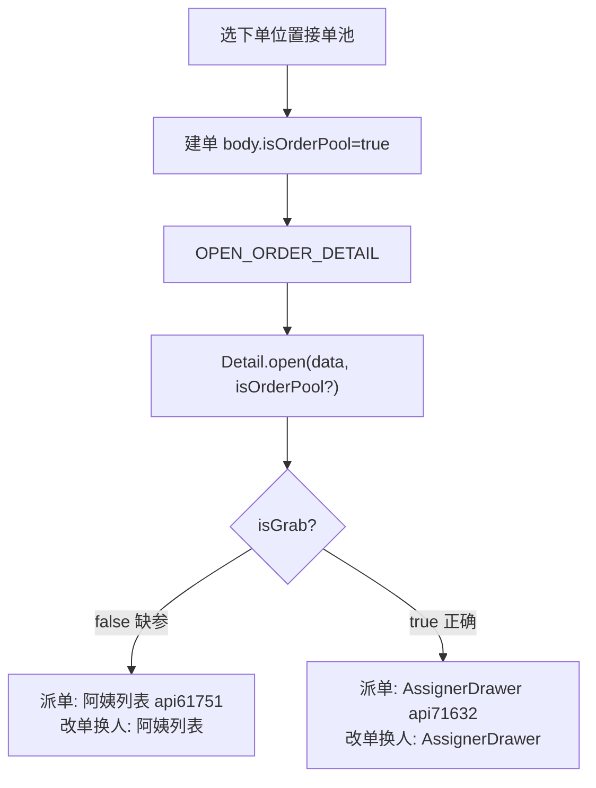

# 11 · 选下单位置后「派单 / 修改订单」缺参根因

返回：[总目录](./README.md)

---

## 结论

**不是「修改订单少一个参数、派单少另一个参数」。**  
两者共用同一个上下文：`Detail` 里的 **`isGrab`**。

选「接单池」下单后若出问题，缺的是打开详情时的：

1. **`open` 第二参**：`isOrderPool` / `isGrab`（布尔）  
2. 和/或行数据上的 **`poolOrderStatus ≠ 0`** / **`isOrderPool`**

缺了 → `isGrab=false` → 派单选阿姨、改单换人也选阿姨；详情还可能打错接口（`api61783` 而非 `api71408`）。



---

## 对比：点击「派单」vs「修改订单」

源码：`src/views/order/detail/index.vue`

| | 派单 | 修改订单 |
|--|------|----------|
| 模板 | `v-if="isGrab"` 两套 `send-order-btn`；接单池分支 `:isGrab="isGrab" :raw="true"` | `edit-combo-btn` **不传** `isGrab` |
| 读上下文 | 父模板 `isGrab` + prop 传给 send-order | `EditOrderInfo` 里 `inject('isGrab')` → `isGrabMode()` |
| isGrab=false | 阿姨列表 → `api61751` | 换人开阿姨列表 |
| isGrab=true | `sendOrders` → AssignerDrawer → `api71632` | 换人开 AssignerDrawer |

**只要打开详情时 `isGrab` 错了，两个按钮会一起错**；不是改单单独缺参。

---

## 缺参发生在哪一层

### 层 A：建单成功事件

`create-order/index.vue`：

```js
emit(OPEN_ORDER_DETAIL, { orderId, isOrderPool: !!isOrderPool.value })
```

若只发 `{ orderId }` → 下游不知道是接单池单。

**当前状态**：已带 `isOrderPool`。

### 层 B：监听方 `open` 第二参

| 页面 | 调用 |
|------|------|
| my-clue / index-simple | `open(res.data, isOrderPool)` |
| customer-follow | `open(res.data, isOrderPool)` |
| order/index | `toDetail(res.data, isOrderPool)` |
| grabOrder | `open(res.data, isOrderPool ?? true)` |

若仍是 `open(res.data)` → **缺的就是这个第二参**。

**当前状态**：上述入口已传第二参。

### 层 C：行数据兜底

`resolveIsGrabFlag` 顺序：显式第二参 → `row.isOrderPool` → `row.poolOrderStatus != 0` → props/query。

`getOrderDetail` 若不回 `poolOrderStatus` / `isOrderPool`，且事件也没带 `isOrderPool`，则必失败。

### 层 D：provide 响应式（改单更敏感）

| 写法 | 结果 |
|------|------|
| `provide('isGrab', isGrab.value)` 布尔快照 | 即使后来 `open(_, true)`，inject 端改单换人仍可能是 false |
| `provide('isGrab', isGrab)` 传 ref | 正确；`isGrabMode()` 用 `unref` |

派单主要看模板 `v-if="isGrab"`；改单换人只靠 inject → **provide 写错时，改单比派单更容易「一直错」**。

**当前状态**：`provide("isGrab", isGrab)` + `isGrabMode()` 已对齐。

---

## 和「订单位置」的关系

位置弹窗只决定建单 `componentProps.isOrderPool` 与提交 body。  

**问题出在「成功后打开详情」没有把「这是接单池单」传进 Detail**，不是位置弹窗少传字段。

---

## 30 秒验收

1. 线索选接单池下单 → 查看订单  
2. Network：详情应为 **`api71408`**，不是 61783  
3. 点派单：应出 **AssignerDrawer（公司）**，不是阿姨列表  
4. 点修改订单 → 换人：同样应是 **AssignerDrawer**

| 现象 | 查 |
|------|-----|
| 2 就不对 | 事件 / `open` 第二参 / `poolOrderStatus` |
| 2、3 对，4 不对 | `provide('isGrab')` 是否仍是布尔快照 |

→ 通用排查：[10-排查手册 §1](./10-排查手册.md)
