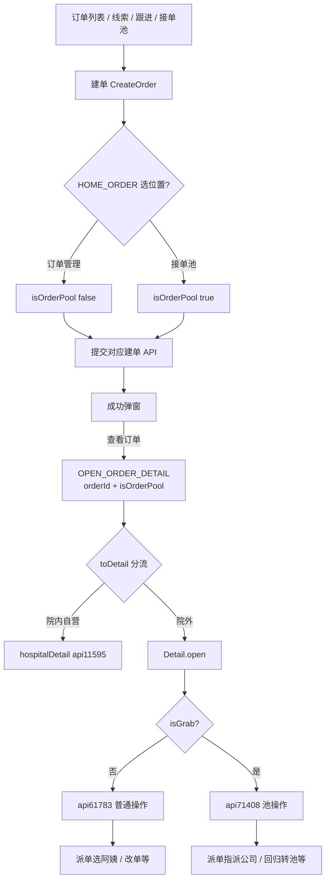

# 订单业务全量流程文档

面向研发 / 测试 / 联调。覆盖：**订单列表、建单、详情打开、头部操作、信息区块、接单池、院内详情、支付合同审批续约、接口事件、排查**。

基准代码：`src/views/order/**`、`src/views/grabOrder/**`、`create-order`、下单位置工具（含 2026-07 接单池详情上下文修复：`Detail.open` 识别 `isOrderPool` / `poolOrderStatus`，`provide(isGrab)` 为响应式）。

---

## 推荐阅读顺序

| 顺序 | 文档 | 适合 |
|------|------|------|
| 1 | 本文（概念 + 总图） | 新人建立心智模型 |
| 2 | [01-订单列表与公共池](./01-订单列表与公共池.md) | 列表入口与公共池差异 |
| 3 | [02-建单全流程](./02-建单全流程.md) | 下单、位置、各 API |
| 4 | [03-详情打开与状态矩阵](./03-详情打开与状态矩阵.md) | isGrab / 按钮矩阵 |
| 5 | [04-详情头部操作详解](./04-详情头部操作详解.md) | 派单 / 改单 / 取消等 |
| 6 | [05-详情信息区块](./05-详情信息区块.md) | 合同 / 财务 / 反馈等卡片 |
| 7 | [06-接单池与抢单](./06-接单池与抢单.md) | 池列表与回归池 |
| 8 | [07-院内订单详情](./07-院内订单详情.md) | hospitalDetail |
| 9 | [08-支付合同审批续约](./08-支付合同审批续约.md) | 支付码 / 审批 / 续约 |
| 10 | [09-接口事件权限清单](./09-接口事件权限清单.md) | 检索表 |
| 11 | [10-排查手册](./10-排查手册.md) | 现象 → 检查点 |

---

## 订单形态（四个世界）

| 形态 | 如何进入 | 详情组件 | 详情 API | 派单 |
|------|----------|----------|----------|------|
| **普通订单** | 下到订单管理，`isOrderPool=false` | `detail/index.vue`，`isGrab=false` | `api61783` | 选阿姨 → `api61751` |
| **接单池订单** | 下到接单池或转池，`isOrderPool=true` / `poolOrderStatus≠0` | 同上，`isGrab=true` | `api71408` | AssignerDrawer → `api71632` |
| **公共池** | URL/props `isPublic=true` | 同上，`showOperation=false` | `api69180` | 无操作工具条 |
| **院内自营** | `orderType===1` 且 `orderTag∉[2,8]` | `hospitalDetail` | `api11595` | 无完整派单工具条 |

---

## 关键标识一览

| 标识 | 含义 | 主要来源 |
|------|------|----------|
| `orderStatus` | 1待支付 2待派单 3待服务 4服务中 8已完成 9已取消 | 详情/列表 |
| `orderType` | 1院内护工 2居家月嫂 3居家护工 4陪诊 | 详情/列表 |
| `orderTag` | 1院内自营 … 2/8 视为「院外化」标签 | 详情/列表 |
| `isOrderPool` | 建单是否进接单池 | attrs / 提交 body / 成功事件 |
| `poolOrderStatus` | 池单状态；`≠0` 按接单池详情打开 | 详情行数据 |
| `isGrab` | 详情是否抢单/池态 | `Detail.open` 解析后 provide |
| `isGrabOrg` | 当前机构是否抢单机构配置 | `api72392` + provide |
| `isPublic` | 订单公共池只读列表 | query / props |
| `showOperation` | 详情是否可操作 | props / query |
| `exceptionOrderList` | 含「未派单」时列表/详情派单按钮可显 | 列表行 |

---

## 全链路总图

---

## 核心源码入口

| 模块 | 路径 |
|------|------|
| 订单列表 | `src/views/order/index.vue` |
| 通用详情 | `src/views/order/detail/index.vue` |
| 院内详情 | `src/views/order/hospitalDetail/index.vue` |
| 接单池列表 | `src/views/grabOrder/table.vue` |
| 建单 | `src/views/system-manage/customer-follow/components/modal/drawer/create-order/index.vue` |
| 下单位置 | `src/utils/orderPoolPosition.ts` |
| 派单按钮 | `src/views/order/component/send-order.vue` |

---

## 深度约定

每章尽量写清：

1. 流程步骤（含分支）  
2. 显示 / 可点条件  
3. 关键文件 + 函数名  
4. 关键接口（封装名 + URL）  
5. 普通 / 接单池 / 公共池 / 院内差异  
