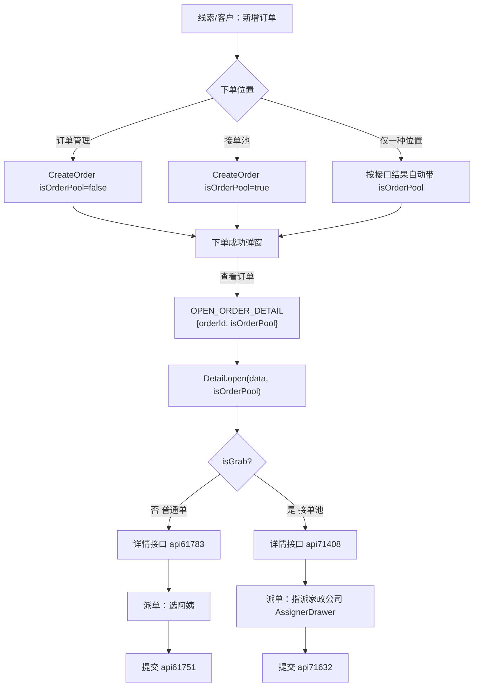

# 接单池 / 普通订单：新增 → 详情 → 派单完整流程

本文说明当前代码下的**正常完整流程**（含 2026-07 接单池详情上下文修复后的行为），便于前后端联调与排查。

---

## 一、两个核心概念

| 概念 | 含义 | 代码标识 |
|------|------|----------|
| **普通订单** | 下到「订单管理」，销售自行选阿姨派单 | `isOrderPool = false`，详情 `isGrab = false` |
| **接单池订单** | 下到「接单池」，由家政公司抢单/被指派 | `isOrderPool = true`，详情 `isGrab = true` |

详情抽屉组件：`src/views/order/detail/index.vue`  
是否接单池态由 `isGrab` 决定，解析优先级：

1. `open(row, isGrabValue)` 显式第二参（下单成功事件会传 `isOrderPool`）
2. 行数据 `row.isOrderPool` / `row.poolOrderStatus != 0`
3. 组件 props / URL query（`isGrab=true`，接单池列表页会写）

---

## 二、总览（一张图）



---

## 三、阶段 1：新增订单 & 选择下单位置

### 3.1 入口（哪里会弹「下单位置」）

| 入口页面 | 路径要点 |
|----------|----------|
| 我的线索 | `my-clue/index.vue` → 更多 → 新增订单 |
| 客户跟进详情 | `customer-follow/index.vue` → 快捷「新增订单」 |
| 阿姨列表（简历场景） | `aunts-list` 且 `enableOrderPositionDialog=true` |

工具函数：`src/utils/orderPoolPosition.ts` → `resolveOrderPoolPosition(customerId)`

### 3.2 位置决策

```text
调用 orderPoolPosition 接口
  ├─ 0 条 / 失败     → 直接打开下单抽屉，按普通单（isOrderPool=false）
  ├─ 1 条            → 不弹窗，按该条 type 决定是否接单池
  └─ 多条            → 弹出 OrderPositionDialog
                         type=1 订单管理 → isOrderPool=false
                         type=2 接单池   → isOrderPool=true
```

### 3.3 下单表单差异（CreateOrder）

- 组件：`customer-follow/.../create-order/index.vue`
- 接单池单：提交参数带 `isOrderPool: true`
- 接单池 + 居间单：**不展示**「选择阿姨」（由池内公司接单/被派）

固定接单池入口（无位置弹窗）：

- 接单池列表页 `grabOrder/table.vue`：写死 `isOrderPool: true`

---

## 四、阶段 2：下单成功 → 打开订单详情

### 4.1 成功弹窗

文案大致为：「订单已下单成功，可前往订单详情查看」

- 点 **查看订单** → 发事件并打开详情
- 点 **取消** → 只关闭，不打开详情

事件：

```js
useMitt.emit(MittEnum.OPEN_ORDER_DETAIL, {
  orderId,
  isOrderPool: !!isOrderPool.value, // 本次是否按下单池
});
```

### 4.2 谁监听并打开详情

| 页面 | 行为 |
|------|------|
| 我的线索 | `getOrderDetail` → `detailRef.open(data, isOrderPool)` |
| 客户跟进（线索详情抽屉打开时走这里） | 同上 |
| 接单池列表 | 先写 query `isGrab=true`，再 `open(data, isOrderPool ?? true)` |
| 订单管理 | `toDetail(data, isOrderPool)` |

### 4.3 详情加载

| isGrab | 详情接口 | 含义 |
|--------|----------|------|
| `false` | `api61783` | 普通订单详情 |
| `true` | `api71408` | 接单池/抢单详情（含抢单人、反馈等字段） |

---

## 五、阶段 3：派单（详情页「派单」按钮）

组件：`send-order.vue` + 详情头上的分支。

### 5.1 普通订单（isGrab = false）

```text
点击「派单」
  → api61759 查询该单已有服务人员
      ├─ 已有服务单 → 弹窗「是否更换护理员」→ 确认后打开阿姨列表
      └─ 无服务单   → 直接打开阿姨列表
  → 在阿姨列表点「派单」
  → api61783 拉订单详情（取末条子单时间）
  → api61751 orderMultiDistributeV2 提交派单
  → 成功提示 → 刷新详情
```

按钮何时显示：`exceptionOrderList` 包含「未派单」（或列表页另有展示条件）。

### 5.2 接单池订单（isGrab = true）

```text
点击「派单」
  → sendOrders() → FeedbackInfo 打开 AssignerDrawer（指派人/家政公司）
  → 选择公司并确认
  → api71632 提交派单
  → 成功 → 刷新详情 / 指派信息
```

按钮何时显示：`isGrab` 为 true 时强制显示。

可旁路反馈：指派抽屉内反馈不可派原因 → FeedbackDialog → 回写状态。

---

## 六、阶段 4：修改订单（与派单相关的换人）

- 按钮组件：`edit-combo-btn.vue`（完结/取消外一般可点）
- 编辑弹层：`editOrderInfo.vue`

换人逻辑：

| 条件 | 行为 |
|------|------|
| `isGrab` 或 `isGrabOrg` | 打开 **AssignerDrawer**（接单池换人） |
| 否则 | 打开 **阿姨列表**（普通换人） |

因此：**只要详情以接单池态打开（isGrab=true），修改订单里的换人与派单一致，都走指派公司，而不是选阿姨。**

---

## 七、按业务场景走读（推荐对照）

### 场景 A：我的线索 → 选接单池 → 查看订单 → 派单

1. 我的线索行操作「新增订单」
2. 弹窗选「接单池」→ 打开 CreateOrder（`isOrderPool=true`）
3. 填单提交成功 →「查看订单」
4. 事件带 `isOrderPool: true` → Detail `isGrab=true` → 拉 `api71408`
5. 点「派单」→ AssignerDrawer → `api71632`

### 场景 B：我的线索 → 选订单管理 → 查看订单 → 派单

1. 选「订单管理」→ CreateOrder（无 `isOrderPool`）
2. 成功查看 → `isGrab=false` → `api61783`
3. 点「派单」→ 阿姨列表 → `api61751`

### 场景 C：接单池列表页直接看单 / 下单

1. 列表本身已是池单；打开详情前写 `query.isGrab=true`，并 `open(..., true)`
2. 本页新增订单固定 `isOrderPool=true`，成功后同样是接单池详情态

### 场景 D：客户详情抽屉内快捷新增

与场景 A/B 相同；因线索详情已打开，由 **CustomerFollow** 监听 `OPEN_ORDER_DETAIL` 打开详情（同样会传 `isOrderPool`）。

---

## 八、关键文件速查

| 职责 | 文件 |
|------|------|
| 下单位置弹窗 | `src/views/customer-manage/component/order-position-dialog/index.vue` |
| 位置解析 | `src/utils/orderPoolPosition.ts` |
| 新增订单 | `src/views/system-manage/customer-follow/components/modal/drawer/create-order/index.vue` |
| 订单详情壳 | `src/views/order/detail/index.vue` |
| 派单按钮 | `src/views/order/component/send-order.vue` |
| 接单池指派抽屉 | `src/views/order/detail/components/assignerDrawer.vue` |
| 反馈/派单入口 | `src/views/order/detail/components/feedbackInfo.vue` |
| 修改订单/换人 | `src/views/order/detail/components/editOrderInfo.vue` |
| 我的线索入口 | `src/views/customer-manage/customer-lead-manage/my-clue/index.vue` |
| 接单池列表 | `src/views/grabOrder/table.vue` |

---

## 九、接口对照（派单相关）

| 用途 | 接口封装 | 说明 |
|------|----------|------|
| 查已有服务单 | `api61759` | 普通派单前是否「已有护理员」 |
| 普通订单详情 | `api61783` | 非池详情 / 普通派单取子单时间 |
| 接单池订单详情 | `api71408` | 池详情 |
| 普通多套餐派单 | `api61751` | 选阿姨提交 |
| 接单池派单 | `api71632` | 指派公司提交 |

---

## 十、排查清单（流程异常时）

1. 下单是否带了 `isOrderPool`？（Network 看创建单 body）
2. 「查看订单」事件是否带 `isOrderPool`？（create-order emit）
3. Detail 打开后 `isGrab` 是否为预期？（详情走的是 71408 还是 61783）
4. 派单弹的是阿姨列表还是 AssignerDrawer？
5. 修改订单换人是否与第 4 点一致？

若接单池单却走进选阿姨，优先查：`open` 第二参 / `poolOrderStatus` / `provide(isGrab)` 是否生效。